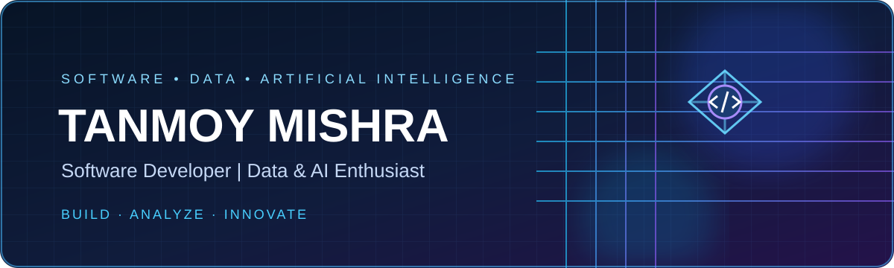

### Software Development · Data Analytics · AI/ML

**MCA Graduate | Python · SQL · Java · PHP · Data Analytics**

---

## About Me

I am an MCA graduate focused on software development, data analytics, and applied AI/ML. My experience combines programming and project work with institutional IT operations, troubleshooting, database and website management, digital operations, and computer science education.

- Building practical applications using **Python, Java, PHP, SQL, and web technologies**.
- Exploring **data analysis, machine learning, NLP, and AI-powered applications**.
- Experienced in IT support, systems coordination, website operations, and technical documentation.
- Former technical content writer/reviewer with **250+ technical articles**.

## Technology Stack

| Domain | Tools and concepts |
|---|---|
| Programming | Python, Java, PHP, JavaScript |
| Database | MySQL, SQL, relational database concepts |
| Data analytics | Pandas, NumPy, Matplotlib, Excel, exploratory data analysis |
| AI / ML | Scikit-learn, TensorFlow/Keras, NLP fundamentals, model evaluation |
| Web | HTML, CSS, JavaScript, PHP |
| Tools | Git, GitHub, Jupyter Notebook, VS Code |
| IT operations | Troubleshooting, networking fundamentals, system support, website operations |

## Featured Projects

### Software and application development

| Project | Description | Stack / focus |
|---|---|---|
| [SevaSankalp](https://github.com/Tanmoy-2001/SevaSankalp) | Healthcare appointment platform with scheduling and patient-support features | Web application |
| [LifeKosh](https://github.com/Tanmoy-2001/LifeKosh) | Blood bank management and coordination platform | Web application |
| [HealthChatbot](https://github.com/Tanmoy-2001/HealthChatbot) | Conversational healthcare information project | Chatbot |
| [GFG Chatbot](https://github.com/Tanmoy-2001/GFG_Chatbot) | Chatbot project | Python / chatbot |
| [Portfolio Website](https://github.com/Tanmoy-2001/Portfolio_website) | Personal portfolio website | Web development |

### Data analytics and machine learning

| Project | Description | Focus |
|---|---|---|
| [Stock Price Prediction](https://github.com/Tanmoy-2001/Stock_prediction_Task1) | Time-series forecasting using an LSTM workflow | Deep learning |
| [Brain Tumor Detection](https://github.com/Tanmoy-2001/BrainTumorDetection_Task-2) | Image-based classification project | Computer vision |
| [Gender and Age Detection](https://github.com/Tanmoy-2001/GoldenProject-2) | Computer vision project for age and gender estimation | OpenCV / CV |
| [Handwritten Digit Recognition](https://github.com/Tanmoy-2001/Number_Recognization_Task3) | Neural-network digit classification using MNIST | Deep learning |
| [Titanic Survival Prediction](https://github.com/Tanmoy-2001/Titanic_Classification_Task2) | Classification using passenger attributes | Machine learning |
| [Unemployment Analysis](https://github.com/Tanmoy-2001/oibsip_task2) | Exploratory analysis of unemployment trends in India | Python / EDA |
| [Car Price Prediction](https://github.com/Tanmoy-2001/oibsip_task3) | Regression-based car price estimation | Machine learning |
| [Email Spam Detection](https://github.com/Tanmoy-2001/oibsip_task4) | Text classification with NLP preprocessing | NLP / classification |
| [Iris Flower Classification](https://github.com/Tanmoy-2001/oibsip_task1) | Classification using the Iris dataset | Machine learning |
| [Color Detection](https://github.com/Tanmoy-2001/ColorDetection_Task-1) | Image colour detection project | Computer vision |

## Professional Experience

- **IT Cell In-Charge / Institutional IT Operations:** IT support, network and system coordination, website and digital content management, troubleshooting, and technology support.
- **PGT Computer Science:** Computer science instruction, practical programming, database concepts, and student project guidance.
- **Technical Content Writer / Reviewer:** 250+ technical articles with an emphasis on clear, search-oriented technical explanations.

## Current Learning Focus

- End-to-end Python and SQL applications
- Data analysis, visualization, and model evaluation
- Machine learning and natural language processing
- Software engineering practices, testing, and deployment
- Cloud and automation fundamentals

## GitHub Activity

## Connect

- **LinkedIn:** [Tanmoy Mishra](https://www.linkedin.com/in/tanmoy-mishra-152483229/)
- **Email:** [tanmoymishra2001@gmail.com](mailto:tanmoymishra2001@gmail.com)
- **GitHub:** [@Tanmoy-2001](https://github.com/Tanmoy-2001)

*Building practical solutions through code, data, and continuous learning.*

